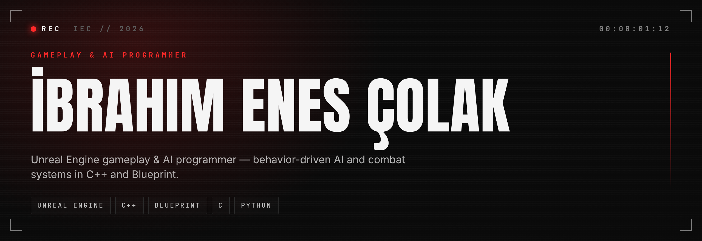
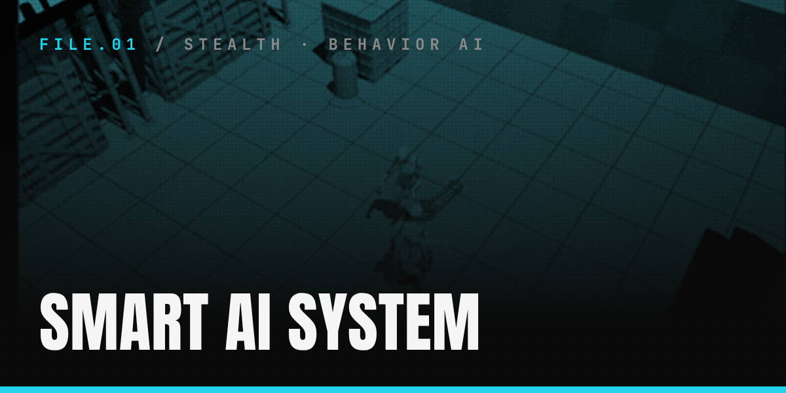
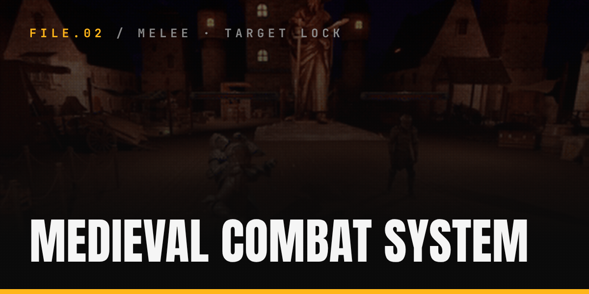
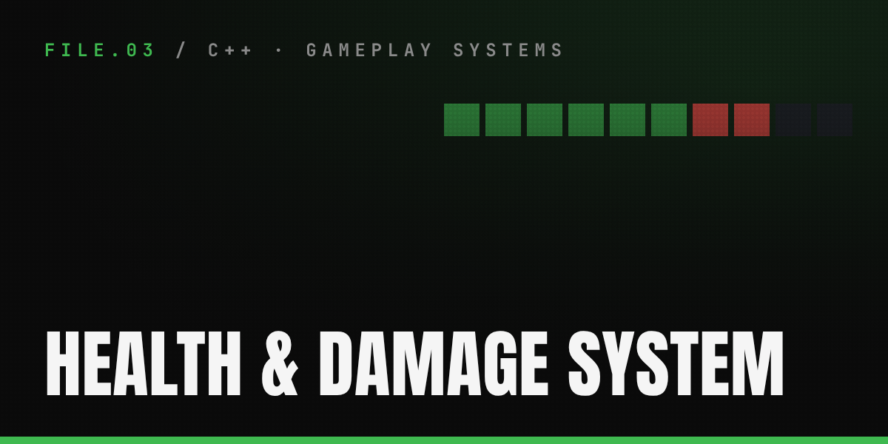
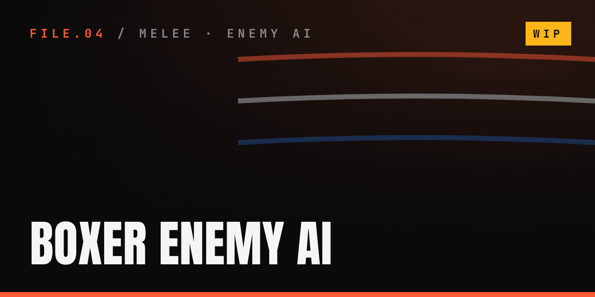
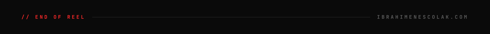

 

## About

I'm a developer with a genuine interest in Unreal Engine, particularly in gameplay and AI. I'm always working to grow further in this direction — currently through 42 Istanbul's Common Core alongside a Software Development degree at Istanbul Aydın University.

 

## Case files

<table>
<tr>
<td width="50%"></td>
<td width="50%"></td>
</tr>
<tr>
<td align="center">Behavior Tree enemy with five states, AI Perception and EQS cover &amp; strafe</td>
<td align="center">Lock-on, fists ⇄ sword, blade-traced hits and directional reactions</td>
</tr>
<tr>
<td width="50%"></td>
<td width="50%"></td>
</tr>
<tr>
<td align="center">Reusable C++ health component: interface, delegates, Blueprint hooks</td>
<td align="center">Prototype melee enemy without a Behavior Tree (being reworked)</td>
</tr>
</table>

 

  

